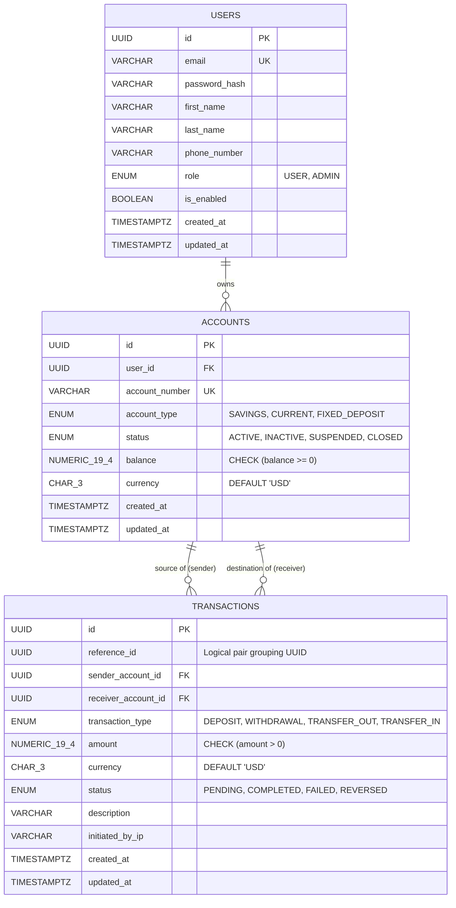

# 🏦 Secure Core Banking & Fund Transfer System

[](https://www.oracle.com/java/)
[](https://spring.io/projects/spring-boot)
[](https://www.mysql.com/)
[](https://reactjs.org/)
[](https://tailwindcss.com/)
[](https://jwt.io/)
[](https://www.docker.com/)

A production-grade, full-stack **Secure Core Banking & Fund Transfer System** engineered to provide enterprise-grade reliability, strict ACID-compliant financial transactions, and modern banking user experiences. Built with a high-throughput **Java Spring Boot 3** backend, **MySQL** persistence with Flyway migrations, and a responsive **React 18 & Tailwind CSS** single-page application.

---

## 📑 Table of Contents

- [Overview & Capabilities](#-overview--capabilities)
- [System Architecture & Engineering Highlights](#-system-architecture--engineering-highlights)
  - [Deadlock Prevention via Deterministic Lock Ordering](#1-deadlock-prevention-via-deterministic-lock-ordering)
  - [ACID Guarantees & Pessimistic Locking](#2-acid-guarantees--pessimistic-locking)
  - [Double-Entry Ledger Bookkeeping](#3-double-entry-ledger-bookkeeping)
  - [High-Precision Monetary Operations](#4-high-precision-monetary-operations)
  - [Multi-Tiered Security & RBAC](#5-multi-tiered-security--rbac)
- [Database Schema & ER Design](#-database-schema--er-design)
- [Tech Stack](#-tech-stack)
- [REST API Specification](#-rest-api-specification)
- [Getting Started](#-getting-started)
  - [Prerequisites](#prerequisites)
  - [1. Database Configuration (MySQL)](#1-database-configuration-mysql)
  - [2. Running the Spring Boot Backend](#2-running-the-spring-boot-backend)
  - [3. Running the React Frontend](#3-running-the-react-frontend)
  - [4. One-Click Full-Stack Launch](#4-one-click-full-stack-launch)
  - [5. Running with Docker Compose](#5-running-with-docker-compose)
- [Concurrency & Integration Testing](#-concurrency--integration-testing)
- [Project Directory Structure](#-project-directory-structure)
- [Environment Variables](#-environment-variables)
- [License](#-license)

---

## 🌟 Overview & Capabilities

Traditional retail and commercial banking engines demand zero tolerance for data anomalies, race conditions, negative balances, and concurrency lockouts. This platform addresses these challenges directly:

- **Deadlock-Free P2P Fund Transfers**: Implements deterministic lexicographical locking over account UUIDs to eliminate circular wait conditions under heavy concurrent workloads.
- **Double-Layer Overdraft Protection**: Strict validation at the application service tier backed by database-level `CHECK (balance >= 0)` constraints.
- **Auditable Double-Entry Ledger**: Every fund transfer automatically generates immutable, paired `TRANSFER_OUT` and `TRANSFER_IN` transaction legs bound by a common `reference_id`.
- **Stateless JWT Security (HS512)**: Role-Based Access Control (`USER` and `ADMIN`) with secure refresh token rotation and method-level authorization (`@PreAuthorize`).
- **Interactive Modern Banking Portal**: Intuitive customer dashboard displaying real-time balances, paginated transaction histories with dynamic multi-criteria filtering, account management, deposit/withdrawal facilities, and instant P2P transfer modals.

---

## 🏛 System Architecture & Engineering Highlights

```
┌─────────────────────────────────────────────────────────────┐
│                   React 18 + Tailwind CSS                   │
│       (Customer Dashboard, Transfers, Ledger History)       │
└──────────────────────────────┬──────────────────────────────┘
                               │ HTTP / REST + Bearer JWT
┌──────────────────────────────▼──────────────────────────────┐
│                    Spring Boot 3 Backend                    │
│ ┌─────────────────────────────────────────────────────────┐ │
│ │ Security Filter Chain (Stateless JWT HS512 + RBAC)     │ │
│ ├─────────────────────────────────────────────────────────┤ │
│ │ Transfer Service (Lexicographical UUID Lock Ordering)   │ │
│ ├─────────────────────────────────────────────────────────┤ │
│ │ Ledger Engine (Double-Entry Debit/Credit Ledger Audit)  │ │
│ └─────────────────────────────────────────────────────────┘ │
└──────────────────────────────┬──────────────────────────────┘
                               │ JDBC (HikariCP / Auto-Commit=false)
┌──────────────────────────────▼──────────────────────────────┐
│                    MySQL Database Engine                    │
│   • Row-Level Locks (SELECT ... FOR UPDATE)                 │
│   • CHECK (balance >= 0) Invariants                         │
│   • B-Tree Indexes on Foreign Keys & Transaction Dates      │
└─────────────────────────────────────────────────────────────┘
```

### 1. Deadlock Prevention via Deterministic Lock Ordering
When two concurrent threads execute mutual transfers simultaneously (e.g., Account A $\rightarrow$ Account B and Account B $\rightarrow$ Account A), uncoordinated row-level locks produce a cyclic wait graph resulting in database transaction deadlocks (`SQLState 40P01` / `Deadlock found when trying to get lock`).

**Our Algorithmic Solution:**
Prior to executing any balance mutation, the `TransferService` determines lock hierarchy by comparing string representations of the source and target UUIDs:

```java
// TransferService.java
UUID firstLockId = sourceId.compareTo(targetId) < 0 ? sourceId : targetId;
UUID secondLockId = sourceId.compareTo(targetId) < 0 ? targetId : sourceId;

// Acquire locks strictly in ordered sequence
Account firstLocked  = accountRepository.findByIdForUpdate(firstLockId);
Account secondLocked = accountRepository.findByIdForUpdate(secondLockId);
```
Because every transaction in the system acquires locks in the identical global order, circular wait conditions become mathematically impossible, eliminating deadlocks entirely.

### 2. ACID Guarantees & Pessimistic Locking
- **Isolation Level**: Set to `Isolation.READ_COMMITTED` to prevent dirty reads.
- **Pessimistic Write Locking**: Utilizes JPA's `LockModeType.PESSIMISTIC_WRITE` translating directly to `SELECT ... FOR UPDATE`.
- **Atomic Rollback**: Configured with `@Transactional(propagation = Propagation.REQUIRED, rollbackFor = Exception.class)`. Any unexpected failure or validation check (e.g., insufficient funds) rolls back both debit and credit legs atomically.

### 3. Double-Entry Ledger Bookkeeping
Every transfer operation records two immutable audit rows:
1. `TRANSFER_OUT` row linked to the sender account with a negative balance delta.
2. `TRANSFER_IN` row linked to the recipient account with a positive balance delta.

Both rows share the exact same `reference_id` UUID, ensuring traceable reconciliation and auditability compliant with financial accounting standards.

### 4. High-Precision Monetary Operations
Floating point types (`float`, `double`) introduce catastrophic precision loss in financial computations. All balances, deposits, withdrawals, and transfers strictly utilize:
- Java: `java.math.BigDecimal` with 4 decimal places and banker's rounding (`RoundingMode.HALF_EVEN`).
- Database: `NUMERIC(19, 4)` columns supporting values up to \$999,999,999,999,999.9999.

### 5. Multi-Tiered Security & RBAC
- **Password Hashing**: BCrypt with salted rounds.
- **Token Infrastructure**: JJWT with HMAC-SHA512 (`HS512`) using cryptographic 512-bit signing keys.
- **Fine-Grained SpEL Authorization**: Method-level security (`@PreAuthorize("@accountSecurity.isOwner(#accountId, authentication)")`) guarantees that customers can only inspect and transact on accounts they legitimately own.

---

## 🗄 Database Schema & ER Design



### Key Integrity Constraints & Indexes
- **`chk_accounts_balance_non_negative`**: Guarantees database-enforced non-negative balance constraint `CHECK (balance >= 0)`.
- **`uq_accounts_number`**: Enforces system-wide uniqueness on generated 12-digit account numbers.
- **`idx_transactions_composite`**: Composite indexes on `(sender_account_id, created_at)` and `(receiver_account_id, created_at)` powering low-latency paginated audit queries.

---

## 💻 Tech Stack

| Domain | Technology | Purpose |
|---|---|---|
| **Backend Core** | Java 17 (OpenJDK) | High-performance, type-safe execution runtime |
| **Framework** | Spring Boot 3.3.4 | Web API, IoC container, enterprise integration |
| **Security** | Spring Security 6 + JJWT 0.12.6 | Stateless JWT authentication (HS512), RBAC |
| **ORM / Data** | Spring Data JPA / Hibernate 6 | Persistence abstraction and pessimistic locking |
| **Database** | MySQL 8.0+ / PostgreSQL 16+ | ACID relational storage with transactional DDL |
| **Migration** | Flyway 10 | Versioned schema migration management |
| **Frontend** | React 18.3 + Vite 5.4 | High-performance client-side SPA rendering |
| **Styling** | Tailwind CSS 3.4 | Responsive, utility-first enterprise UI system |
| **HTTP Client** | Axios 1.7 | Interceptor-driven authenticated REST communication |
| **Icons & UX** | Lucide React | Modern visual iconography |
| **Containerization** | Docker & Docker Compose | Multi-container reproducible production stack |

---

## 📡 REST API Specification

### 1. Authentication Endpoints (`/api/v1/auth`)
| Method | Endpoint | Access | Description |
|---|---|---|---|
| `POST` | `/api/v1/auth/register` | Public | Register new customer account (`USER` role) |
| `POST` | `/api/v1/auth/login` | Public | Authenticate credentials and receive Access & Refresh JWTs |
| `POST` | `/api/v1/auth/refresh` | Public | Exchange valid Refresh Token for a new Access Token |

### 2. Account Management (`/api/v1/accounts`)
| Method | Endpoint | Access | Description |
|---|---|---|---|
| `POST` | `/api/v1/accounts` | Authenticated | Open new account (`SAVINGS`, `CURRENT`, `FIXED_DEPOSIT`) |
| `GET` | `/api/v1/accounts` | Authenticated | Fetch all accounts owned by the authenticated customer |
| `GET` | `/api/v1/accounts/{id}` | Owner / Admin | Retrieve balance and account status details |
| `POST` | `/api/v1/accounts/{id}/deposit` | Owner / Admin | Deposit funds into specified account |
| `POST` | `/api/v1/accounts/{id}/withdraw` | Owner / Admin | Withdraw funds (overdraft protected) |
| `GET` | `/api/v1/accounts/admin/user/{userId}` | Admin | Query accounts belonging to any system user |

### 3. P2P Fund Transfers (`/api/v1/transfers`)
| Method | Endpoint | Access | Description |
|---|---|---|---|
| `POST` | `/api/v1/transfers` | Owner (Source) | Execute P2P transfer with deadlock-free locking |
| `GET` | `/api/v1/transfers/{id}` | Party / Admin | Retrieve transfer details by transaction or reference UUID |

#### Sample Transfer Request Payload:
```json
{
  "sourceAccountId": "a81bc81b-dead-4e5d-abff-90865d1e13b1",
  "targetAccountNumber": "489201928301",
  "amount": 250.00,
  "description": "Invoice #1042 Settlement"
}
```

### 4. Transaction History & Audit (`/api/v1`)
| Method | Endpoint | Access | Description |
|---|---|---|---|
| `GET` | `/api/v1/accounts/{accountId}/transactions` | Owner / Admin | Paginated & filtered ledger history |
| `GET` | `/api/v1/transactions/{transactionId}` | Party / Admin | Retrieve specific transaction details |

#### Query Parameters Supported:
- `page` (default `0`), `size` (default `10`)
- `sortBy` (e.g., `createdAt`), `direction` (`ASC` / `DESC`)
- `type` (`DEPOSIT`, `WITHDRAWAL`, `TRANSFER_OUT`, `TRANSFER_IN`)
- `status` (`COMPLETED`, `PENDING`, `FAILED`)
- `startDate` & `endDate` (ISO-8601 strings)

---

## 🚀 Getting Started

### Prerequisites
- **Java Development Kit (JDK)**: Version 17 or higher
- **Apache Maven**: Version 3.8+ (or use `./mvnw`)
- **Node.js**: Version 18.x or 20.x & `npm`
- **MySQL**: Server 8.0+ running locally (or via Docker)

---

### 1. Database Configuration (MySQL)

Create the banking database in your local MySQL instance:

```sql
CREATE DATABASE banking CHARACTER SET utf8mb4 COLLATE utf8mb4_unicode_ci;
```

Verify your database credentials in `src/main/resources/application.yml` (or provide environment variables):

```yaml
spring:
  datasource:
    url: jdbc:mysql://${DB_HOST:localhost}:${DB_PORT:3306}/${DB_NAME:banking}?useSSL=false&serverTimezone=UTC&allowPublicKeyRetrieval=true
    username: ${DB_USERNAME:root}
    password: ${DB_PASSWORD:Mysql@123}
    driver-class-name: com.mysql.cj.jdbc.Driver
```

---

### 2. Running the Spring Boot Backend

Compile and start the Spring Boot application using Maven:

```bash
# Clean and run the application
mvn clean spring-boot:run
```

The backend server boots on **`http://localhost:8080`**.
Flyway migrations will automatically execute on startup, initializing the database schema and indexes.

You can verify health status at:
```bash
curl http://localhost:8080/actuator/health
```

---

### 3. Running the React Frontend

Navigate to the `frontend` directory, install npm packages, and launch Vite dev server:

```bash
# Navigate to frontend folder
cd frontend

# Install dependencies
npm install

# Start Vite development server
npm run dev
```

The frontend will start at **`http://localhost:3000`** (or `http://localhost:5173`). Open the URL in your browser to access the banking portal.

---

### 4. One-Click Full-Stack Launch

For convenience, cross-platform startup automation scripts are included:

#### On Windows (PowerShell):
```powershell
.\start.ps1
```

#### On Windows (Command Prompt):
```cmd
start.bat
```

#### On Linux / macOS:
```bash
chmod +x start.sh
./start.sh
```

#### Or via Node Workspace:
```bash
npm install
npm run dev
```
These scripts automatically launch the Spring Boot backend, poll `http://localhost:8080/actuator/health` until the API is fully initialized, and then launch the React frontend.

---

### 5. Running with Docker Compose

Deploy the complete multi-tier architecture in isolated containers:

```bash
# Start MySQL/PostgreSQL, Backend, and Frontend containers
docker compose up --build -d

# Check running services
docker compose ps

# View container logs
docker compose logs -f
```

Services will be mapped to:
- **Frontend**: `http://localhost` (Port 80)
- **Backend API**: `http://localhost:8080`
- **Database**: Port 5432 / 3306

---

## 🧪 Concurrency & Integration Testing

The project includes an automated multi-threaded stress test ([`ConcurrentTransferIntegrationTest.java`](file:///c:/Users/annam/Downloads/banking%20web/src/test/java/com/banking/core/service/ConcurrentTransferIntegrationTest.java)) designed to simulate mutual concurrent transfers across multiple worker threads using `CountDownLatch`.

Run the test suite via Maven:

```bash
# Run specific concurrency integration test
mvn test -Dtest=ConcurrentTransferIntegrationTest

# Run all unit and integration tests
mvn test
```

This validates that:
1. No thread deadlocks occur under reciprocal concurrent fund transfers.
2. The total sum of balances across all accounts remains strictly invariant (Conservation of Money).
3. Database `CHECK (balance >= 0)` constraints prevent any negative balance breach.

---

## 📁 Project Directory Structure

```
banking-web/
├── .github/                     # GitHub workflows and CI/CD pipelines
├── frontend/                    # React 18 + Vite + Tailwind CSS Single-Page Application
│   ├── src/
│   │   ├── api/                 # Axios client and JWT interceptors
│   │   ├── components/          # Reusable UI widgets (Navbar, Sidebar, Modals, Toasts)
│   │   ├── context/             # Authentication & User state contexts
│   │   ├── pages/               # Dashboard, Login, Register, Transfers, History
│   │   ├── App.jsx              # Application router & layout definition
│   │   └── main.jsx             # Entry point
│   ├── Dockerfile               # Production multi-stage Nginx container build
│   ├── nginx.conf               # Nginx reverse proxy configuration
│   ├── package.json             # Frontend dependencies and scripts
│   ├── tailwind.config.js       # Tailwind design tokens
│   └── vite.config.js           # Vite dev server & proxy settings
├── src/
│   ├── main/
│   │   ├── java/com/banking/core/
│   │   │   ├── config/          # Security, Web & Application Bean configurations
│   │   │   ├── controller/      # REST API Controllers (Auth, Account, Transfer, Ledger)
│   │   │   ├── domain/          # Entities & Enums (User, Account, Transaction)
│   │   │   ├── dto/             # Request payloads & Response DTOs
│   │   │   ├── exception/       # GlobalExceptionHandler & custom banking exceptions
│   │   │   ├── repository/      # JPA Repositories & Dynamic Specifications
│   │   │   ├── security/        # JWT Authentication Filter, Evaluator & Services
│   │   │   └── service/         # Core banking logic, P2P Transfers & Locking
│   │   └── resources/
│   │       ├── application.yml  # Application properties & datasource profiles
│   │       └── db/migration/    # Flyway schema version migrations
│   └── test/                    # Concurrency stress tests & Unit test suites
├── docker-compose.yml           # Multi-service production container topology
├── Dockerfile                   # Spring Boot container buildfile
├── pom.xml                      # Maven project configuration & dependencies
├── package.json                 # Root workspace orchestrator
├── start.ps1 / start.bat        # Automated full-stack dev runners
└── README.md                    # System documentation
```

---

## 🔐 Environment Variables

| Variable | Description | Default Value |
|---|---|---|
| `SERVER_PORT` | HTTP port for Spring Boot application | `8080` |
| `DB_HOST` | Database host | `localhost` |
| `DB_PORT` | Database port | `3306` (MySQL) / `5432` |
| `DB_NAME` | Database schema name | `banking` |
| `DB_USERNAME` | Database username | `root` |
| `DB_PASSWORD` | Database user password | `Mysql@123` |
| `JWT_SECRET` | 512-bit Base64-encoded secret key for HS512 JWT | *(Auto-generated default for dev)* |
| `JWT_EXPIRATION` | Access token lifespan in milliseconds | `86400000` (24h) |
| `JWT_REFRESH_EXPIRATION` | Refresh token lifespan in milliseconds | `604800000` (7d) |

---

## 📄 License

This project is licensed under the [MIT License](LICENSE).
Feel free to use and adapt this system for academic, development, and enterprise core banking implementations.
